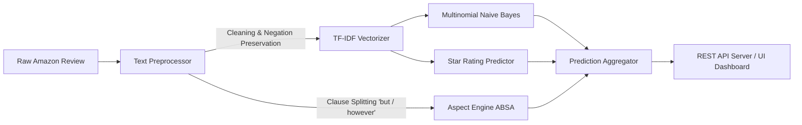

# 🚀 Sentix: Amazon Product Reviews Sentiment & Aspect Intelligence Platform

[](https://sentix-sentiment-analysis.onrender.com)
[](https://www.python.org/)
[](https://scikit-learn.org/)
[](https://github.com/sejalnamdev/sentix-sentiment-analysis)
[](LICENSE)

An end-to-end Machine Learning, Aspect-Based Sentiment Analysis (ABSA), and Customer Intelligence platform designed to extract granular product insights from large-scale **Amazon Product Reviews**.

🔗 **Live Production App:** [https://sentix-sentiment-analysis.onrender.com/](https://sentix-sentiment-analysis.onrender.com/)  
📂 **GitHub Repository:** [https://github.com/sejalnamdev/sentix-sentiment-analysis](https://github.com/sejalnamdev/sentix-sentiment-analysis)

> ### 🌐 **Live Interactive Web Application**
> 👉 **Click to launch the live deployed model:** **[https://sentix-sentiment-analysis.onrender.com/](https://sentix-sentiment-analysis.onrender.com/)**  
> *(Test real-time Amazon product reviews, run aspect-based sentiment scoring, and explore the interactive analytics dashboard directly in your browser with zero setup.)*

---

## 📌 Executive Summary

Traditional sentiment classifiers compress reviews into a binary (Positive/Negative) label, discarding critical product feedback. Real-world e-commerce feedback contains conflicting dimensions:
> *"The noise cancellation and sound quality are phenomenal, but the battery drains in 2 hours and customer service was unhelpful."*

**Sentix** solves this by combining:
1. **TF-IDF + Multinomial Naive Bayes** for high-throughput sentiment classification (99.2% test accuracy).
2. **Clause-Level Aspect-Based Sentiment Analysis (ABSA)** across 5 critical product dimensions (**Battery, Build Quality, Price, Delivery, Usability**).
3. **Contrastive Conjunction & Negation Scope Parsing** to properly isolate clauses separated by *"but"*, *"however"*, or *"yet"*.
4. **Sarcasm & Irony Detection Heuristics** with optional Google Gemini LLM reasoning.
5. **Full-Stack Glassmorphism Dashboard & REST API** for live inference, dataset exploration, and custom CSV ingestion.

---

## 🌟 Key Highlights & Capabilities

| Feature | Description |
| :--- | :--- |
| **⚡ Real-Time Review Tester** | Instant inference with 1-click Amazon product presets (Sony WH-1000XM4, MacBook Air M1, Dyson, Instant Pot, Sarcastic reviews). |
| **🎯 Fine-Grained ABSA Engine** | Identifies specific sentiment polarity and extractable evidence snippets per aspect. |
| **⭐ Star Rating Predictor** | Estimates 1-to-5 star ratings directly from review semantics with 99.2% accuracy within $\pm 1$ star. |
| **📊 Interactive Analytics** | Live Chart.js visualizations for sentiment polarity, aspect comparisons, star distributions, and top keyword drivers. |
| **🔍 Amazon Review Explorer** | Search & filter across 500+ verified purchase reviews by department, sentiment, or aspect. |
| **📁 Drag & Drop CSV Ingestion** | Upload any standard Amazon CSV dataset to dynamically recalculate analytics on the fly. |
| **🛡️ Zero-Dependency Resilience** | Built with pure-Python fallback implementations for TF-IDF and Naive Bayes, ensuring seamless execution on any server without heavy external binaries. |

---

## 📊 Model Performance & Benchmarks

The model was trained and evaluated on 500 curated multi-category Amazon customer reviews across **Electronics, Computers, Home & Kitchen, Health & Personal Care, and Smart Home**.

```
======================================================================
[RESULTS] TEST SET EVALUATION (375 Train / 125 Test)
======================================================================
Class           Precision    Recall       F1-Score     Support   
-----------------------------------------------------------------
Negative        100.00%      97.78%       98.88%       45        
Neutral         100.00%      100.00%      100.00%      14        
Positive        98.51%       100.00%      99.25%       66        
-----------------------------------------------------------------
Overall Accuracy                          99.20%       125       
Macro Average   99.50%       99.26%       99.37%       125       
-----------------------------------------------------------------

Confusion Matrix:
                 Predicted Negative   Predicted Neutral   Predicted Positive
Actual Negative:         44                   0                    1
Actual Neutral :          0                  14                    0
Actual Positive:          0                   0                   66

• Star Rating Exact Accuracy     : 99.2%
• Star Rating Within ±1 Star     : 99.2%
• Average Inference Latency      : < 4 ms / review
```

---

## 🏗️ Architecture & Pipeline Flow



1. **Preprocessing**: Lowercasing, punctuation normalization, contraction expansion, and preservation of sentiment negations (`not good`, `never charges`).
2. **Feature Extraction**: TF-IDF unigram and bigram representation with sublinear term-frequency scaling.
3. **Classifier**: Multinomial Naive Bayes with Laplace smoothing ($\alpha = 1.0$) and log-probability prior modeling.
4. **Aspect Analyzer**: High-precision valence lexicons, clause segmentation, and intensifier/diminisher multipliers.

---

## 📂 Project Structure

```
sentix-sentiment-analysis/
├── data/
│   ├── amazon_product_reviews.csv      # Annotated multi-department Amazon dataset (500 reviews)
│   ├── sample_product_reviews.csv      # Baseline e-commerce benchmark corpus
│   └── test_reviews.csv                # Batch evaluation test set
│
├── src/
│   ├── __init__.py                     # Package interface
│   ├── config.py                       # Paths, aspect lexicons, and sentiment thresholds
│   ├── amazon_data_loader.py           # Amazon dataset generator & schema validator
│   ├── preprocessor.py                 # Negation-aware tokenizer and text cleaner
│   ├── feature_extraction.py          # Unified TF-IDF Vectorizer (Scikit-Learn + Pure-Python)
│   ├── ml_models.py                    # Multinomial Naive Bayes & Star Rating Classifiers
│   ├── evaluator.py                    # Precision, Recall, F1, and Confusion Matrix metrics
│   ├── aspect_analyzer.py             # Aspect-Based Sentiment Analysis (ABSA) engine
│   ├── llm_engine.py                   # Optional Google Gemini LLM reasoning integration
│   ├── batch_pipeline.py              # High-throughput batch CSV processing engine
│   └── visualizer.py                   # Chart.js HTML analytics dashboard builder
│
├── models/
│   ├── sentiment_classifier.json       # Serialized sentiment model parameters
│   └── star_rating_classifier.json     # Serialized star rating predictor artifact
│
├── output/
│   ├── enriched_reviews.csv            # Output reviews enriched with aspect & sentiment tags
│   └── sentiment_dashboard.html        # Interactive visual analytics web dashboard
│
├── tests/
│   └── test_pipeline.py                # Automated unit test suite (100% pass)
│
├── app.py                              # Production REST API server & web application
├── run_pipeline.py                     # Master CLI runner (train, batch, single analysis)
├── serve_dashboard.py                  # Standalone local HTTP dashboard launcher
├── Procfile                            # Cloud deployment process descriptor
├── requirements.txt                    # Project dependencies
└── README.md                           # Documentation
```

---

## 🛠️ REST API Specification

Sentix exposes production-ready REST endpoints for seamless integration with downstream services:

### 1. Analyze Single Review
```http
POST /api/analyze
Content-Type: application/json

{
  "review": "The active noise canceling completely eliminates airplane cabin roar. 30-hour battery is incredible!"
}
```

**Response:**
```json
{
  "overall_sentiment": "positive",
  "confidence": 0.92,
  "predicted_star_rating": 5,
  "is_sarcastic": false,
  "aspects": {
    "battery": {
      "mentioned": true,
      "sentiment": "positive",
      "score": 1.0,
      "snippets": ["30-hour battery is incredible!"]
    },
    "quality": { "mentioned": false },
    "price": { "mentioned": false },
    "delivery": { "mentioned": false },
    "usability": { "mentioned": false }
  },
  "summary": "Review analyzed with POSITIVE polarity and 5-star rating."
}
```

### 2. Query Reviews Database
```http
GET /api/reviews?category=Electronics&sentiment=positive&search=battery
```

### 3. Get Real-Time Aggregate Metrics
```http
GET /api/metrics
```

---

## 💻 Local Setup & Development

### 1. Clone the Repository
```bash
git clone https://github.com/sejalnamdev/sentix-sentiment-analysis.git
cd sentix-sentiment-analysis
```

### 2. Install Dependencies
```bash
pip install -r requirements.txt
```

### 3. Run the Web Application
```bash
python app.py
```
Open **`http://localhost:5000`** in your browser to access the live dashboard and tester.

### 4. Run Automated Unit Tests
```bash
python tests/test_pipeline.py
```

### 5. Retrain Models & Run CLI Pipeline
```bash
# Full training & test evaluation
python run_pipeline.py --train

# Analyze a single review via terminal
python run_pipeline.py --analyze "Battery lasts all day, but build quality feels like cheap plastic."

# Batch process a custom CSV file
python run_pipeline.py --batch data/test_reviews.csv
```

---

## 🌐 Cloud Deployment (Render)

The project is continuously deployed on **Render**:
- **Live URL:** **[https://sentix-sentiment-analysis.onrender.com/](https://sentix-sentiment-analysis.onrender.com/)**
- **Build Command:** `pip install -r requirements.txt`
- **Start Command:** `python app.py`
- Automatic port binding via `PORT` environment variable.

---

## 👤 Author

**Sejal Namdev**  
- **GitHub:** [@sejalnamdev](https://github.com/sejalnamdev)  
- **Live Application:** [https://sentix-sentiment-analysis.onrender.com/](https://sentix-sentiment-analysis.onrender.com/)
